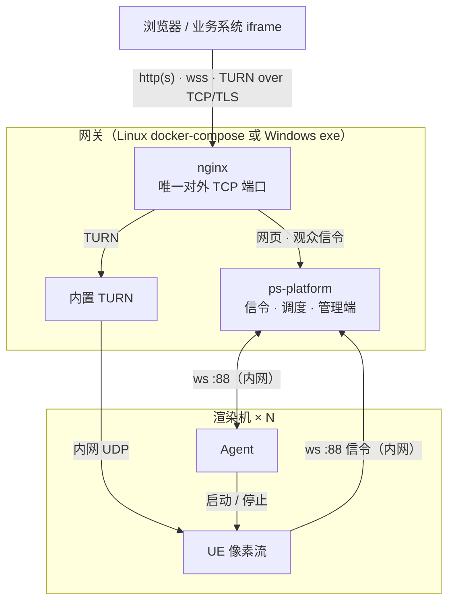

# ps-platform —— UE 像素流云渲染管理平台

[](https://github.com/sreyun/ueps/actions/workflows/ci.yml)
[](https://github.com/sreyun/ueps/releases/latest)


一套程序完成 **信令 + 实例调度 + 管理端 + TURN 中继**，经 nginx **单个 TCP 端口**对外提供 UE 像素流画面：
公网 / 客户现场只需开放一个端口，**不需要任何 UDP 端口映射**；内网、跨网、路由器端口映射、域名访问均无需改配置。
覆盖并取代原 PeerStreamEnterprise 的全部功能，原有 `video.html?urlPrefix=…` 访问与嵌入方式保持不变。

- [工作原理](#工作原理) · [特性](#特性) · [下载](#下载) · [快速开始](#快速开始) · [接入渲染机](#接入渲染机) · [访问地址与嵌入](#访问地址与嵌入) · [端口](#端口) · [文档](#文档) · [构建与发布](#构建与发布) · [开发](#开发)

## 工作原理



浏览器与网关之间只有一条 TCP（网页、信令、TURN 在 nginx 的同一端口多路复用），网关上的 TURN 再在内网用 UDP 与 UE 互通；内网观众在 ICE 择优时自动直连 UE。

## 特性

| | |
|---|---|
| **零 UDP 映射** | TURN over TCP/TLS 与网页同端口多路复用；同一端口同时支持 `http://` 与 `https://`；前面还有一层反向代理（路由器、OpenResty、CDN）时也能用（见安装手册 8.1） |
| **按需调度** | 独占（一人一实例）/ 共享（多人同看）；预热（可按时段）、空闲回收、排队、失败自动换 GPU / 机器重试、排空、每位观众使用全新实例（用后即关）；VIP 访问链接（排队优先，满员时抢占）；按 GPU 显存 / 利用率放置，支持手动定义 GPU |
| **渲染机一键接入** | Windows 10/11 图形安装程序（复制安装链接 → 双击「下一步」，默认作为 Windows 服务开机运行，可修改 / 升级 / 卸载 / 静默批量部署）；Linux 一条命令 |
| **稳定** | 平台或 Agent 重启后自动接管仍在运行的 UE（不重复拉起、不留孤儿进程）；僵尸 UE 重连被拒；心跳检测；TURN 子进程守护；Agent 守护进程自动重启 |
| **安全** | 管理端 / UE / Agent 只在内网口，观众口与管理口分离；scrypt 口令、两步验证、会话吊销、登录锁定、CSRF 防护、API 令牌、单点登录（业务系统一次性登录链接）、访问链接、IP 白名单、限流、审计；Agent 可执行文件目录白名单、参数数组启动（无 shell 注入） |
| **好用** | Web 管理端（首次使用引导、概览、程序与访问〔一键复制播放地址 / 嵌入代码〕、实例、渲染机 / GPU、观众会话与质量〔CSV 导出〕、访问链接、用户、设置、日志、审计；适配手机）；告警（企业微信 / 钉钉 / 飞书 / Webhook）、Prometheus 指标、备份恢复、自定义网页托管、企业版兼容接口（寻路、坐标转换） |
| **性能** | 1000 并发观众 p99 ≈ 300ms 拿到画面协商，平台内存约 120MB（安装手册第 12 节） |
| **部署** | 单文件可执行程序（Windows / Linux，无需安装 Node.js）、docker-compose、华为云 SWR 预构建镜像（amd64 / arm64）；兼容 UE4.27 / UE5 像素流 1 / UE5.5 像素流 2 |

## 下载

[GitHub Releases](https://github.com/sreyun/ueps/releases/latest) 每个版本提供：

| 文件 | 用途 |
|---|---|
| `ps-platform-<版本>-windows-x64.zip` | 平台 · Windows（内含 `ps-platform.exe`、管理端、nginx 配置、文档） |
| `ps-platform-<版本>-linux-x64.tar.gz` | 平台 · Linux x64（内含 `ps-platform`，glibc ≥ 2.28） |
| `ps-platform-agent-setup-<版本>.exe` | 渲染机 · Windows 10/11 图形安装程序（一般不必单独下载，管理端会提供） |
| `ps-platform-agent-<版本>-linux-x64` | 渲染机 · Linux Agent 程序 |
| `SHA256SUMS.txt` | 校验和 |

Docker 镜像：`swr.cn-east-3.myhuaweicloud.com/sreyun/ps-platform:<版本>`（标签 `1.5.0` / `1.5` / `1` / `latest`）。

## 快速开始

### A. Linux 网关 + docker-compose（推荐）

```bash
cd deploy && cp .env.example .env && vi .env     # 建议填写 PS_ADMIN_PASSWORD、PS_AGENT_TOKEN、TURN_SECRET（网段等参数可在管理端维护）
mkdir -p certs                                   # 可选：放入 fullchain.pem / privkey.pem 启用 https；没有证书时以仅 http 模式运行
docker compose up -d --build                     # 或在 .env 设置 PS_IMAGE=swr.cn-east-3.myhuaweicloud.com/sreyun/ps-platform:1.5.0 后：
                                                 #   docker compose pull platform && docker compose up -d --no-build
docker compose ps                                # platform、nginx 均为 healthy
```

- 管理端：`http://<网关内网 IP>:88/admin/`（用户名 `admin`，仅内网）。观众：`http(s)://<域名或IP[:映射端口]>/`。
- 没有 UE 时先看效果：`docker compose -f docker-compose.yml -f docker-compose.demo.yml up -d --build`（无头浏览器充当 UE，推送测试画面）。

### B. Windows / Linux 直接运行

```powershell
# Windows（单机：UE 与平台在同一台电脑时，平台内置本机 Agent，无需另外接入）
copy config.example.json config.json   # 可选：端口等启动参数；UE 目录等在管理端「系统设置」中维护
.\ps-platform.exe                       # 管理端 http://<本机IP>:88/admin/ ，初始口令见 data\initial-admin.txt
```

```bash
# Linux
tar -xzf ps-platform-<版本>-linux-x64.tar.gz && cd ps-platform-<版本>-linux-x64
cp config.example.json config.json && ./ps-platform
```

对外服务配合包内 `nginx/nginx.conf`（单端口多路复用），注册为系统服务见安装手册第 4 节。

### 首次登录

按「概览 → 开始使用」引导完成：① 系统设置 → 访问与嵌入 → 填写**对外访问地址**；② 接入渲染机；③ 新建程序（填写 UE 可执行文件路径）；④ 在「程序与访问」点「访问」复制播放地址或嵌入代码。

## 接入渲染机

**Windows 10 / 11（图形安装）**

1. 管理端「渲染机 / GPU → 接入渲染机」点 **复制安装链接**（24 小时有效），在渲染机的浏览器中打开，下载安装程序（已包含平台地址与接入令牌）。
2. 双击运行，按「下一步」：确认平台（自动检测连接）→ 机器名称、UE 程序所在文件夹 → 运行方式 → 安装。
3. 完成后渲染机自动出现在列表中。修改设置再次运行安装程序；卸载在 Windows「设置 → 应用」中进行。

批量部署可静默安装：`Start-Process -Wait .\ps-platform-agent-setup.exe -ArgumentList '/S','/id=render-01','/allow-exe=D:\UEProject'`。
Docker / Linux 部署的平台首次需在该页点「从发布页获取」（或上传）安装程序，Windows 版平台会用自身自动生成。

**Linux**：同一页面复制命令执行：

```bash
curl -fL -o ps-platform http://<网关>:88/download/agent/linux && chmod +x ps-platform
./ps-platform --agent --url ws://<网关>:88/agent --token <令牌> --id render-01 --allow-exe /opt/ue
```

详见安装手册第 5 节（参数、systemd、令牌轮换）。

## 访问地址与嵌入

所有地址走 nginx 的同一个对外端口，`http://` 与 `https://` 均可：

| 地址 | 说明 |
|---|---|
| `/video.html?urlPrefix=<程序ID>` | 与企业版完全一致，原有链接 / 嵌入代码无需修改 |
| `/play/<程序ID>` | 推荐写法 |
| `/<程序ID>` | 兼容写法 |
| `&token=…` | 程序要求访问链接时，用管理端「访问链接」生成的令牌 |
| `stats=1` / `relay=1` / `ui=0` | 状态浮层 / 强制中继 / 隐藏播放页控制栏（嵌入时使用） |
| `/embed-demo.html?urlPrefix=<程序ID>` | 全屏嵌入效果演示 |

```html
<iframe src="https://ue.example.com:8443/video.html?urlPrefix=JJQ"
        allow="autoplay; fullscreen; clipboard-read; clipboard-write"
        style="border:0;width:100%;height:100%"></iframe>
```

业务系统是 https 页面时必须嵌入 https 地址，且需要受信任的证书。管理端「程序与访问 → 访问」可一键复制各种地址与嵌入代码。

## 端口

| 端口 | 谁访问 | 说明 |
|---|---|---|
| 443（可改 / 映射为任意外网端口） | 浏览器 | **唯一需要对外开放的端口**：网页、观众信令、TURN/TURNS 共用 |
| 80（可选） | 浏览器 | http 访问、跳转、证书签发 |
| 88 | 内网运维、UE、Agent | 管理端 / API / UE 信令 / Agent 连接 / 渲染机下载安装包。**不要对公网开放** |
| 49160-50159/udp | UE 渲染机 | TURN 中继端口，只在内网使用，无需映射 |

## 文档

| 文档 | 内容 |
|---|---|
| [docs/INSTALL.md](docs/INSTALL.md) | 安装、配置、启动、渲染机接入、访问与嵌入、网络场景、验证、排障、运维、实测数据、构建发布 |
| [docs/API.md](docs/API.md) | REST API、API 令牌、二次开发、播放页嵌入与 SDK、关闭码 |
| [docs/DESIGN.md](docs/DESIGN.md) | 架构设计 |
| [CHANGELOG.md](CHANGELOG.md) | 更新记录 |
| [NOTICE.md](NOTICE.md) | 来源与第三方组件说明 |

## 构建与发布

| 工作流 | 触发 | 内容 |
|---|---|---|
| `ci.yml` | 每次推送 / PR | Node 22 / 26 全部测试、依赖审计、语法检查、Windows 安装程序编译、镜像构建与启动自检 |
| `release.yml` | 推送 `v*` 标签 | 校验版本号 → 测试 → Windows / Linux 打包与冒烟测试 → 上传到 GitHub Release |
| `docker.yml` | 推送 `v*` 标签 | 构建 amd64 + arm64 镜像，自检后推送华为云 SWR（需配置 `HW_ACCESS_KEY` / `HW_SECRET_KEY`） |

发布新版本：修改 `package.json`、`src/app.js` 与 `agent/agent.js` 中的版本号，在 `CHANGELOG.md` 增加对应一节，推送 main 后打标签 `git tag -a v1.5.0 -m "ps-platform 1.5.0" && git push origin v1.5.0`。详见安装手册第 13 节。

## 开发

```bash
npm install            # 运行时依赖只有 ws；打包需要 esbuild（devDependency）
npm test               # 单元 + 集成测试（node:test）
npm start              # 启动（读取 config.json）
npm run build:exe      # 打包到 dist/（Windows 上同时编译渲染机安装程序，需系统自带的 .NET Framework 4.x）
node test/load/platform-load.js --admin http://127.0.0.1:88 --public ws://127.0.0.1:8088 --user admin --password <口令> --players 300   # 并发压测
```

```
server.js          入口（平台 / --agent 渲染机代理 / --turn 中继，一个程序三种角色）
src/               平台：app、api、signaling、scheduler、agents、store、settings、downloads…
agent/             渲染机代理（Agent）
agent-setup/       Windows 渲染机图形安装程序（C#，系统自带 csc 编译）
lib/turn-tcp.js    TURN 中继
admin/             管理端（Preact + htm，无需构建）
public/            播放页、门户页与 SDK
deploy/            docker-compose、Dockerfile、nginx 配置
build/             单文件可执行程序打包
test/              单元 / 集成 / 压测 / 端到端测试
```
